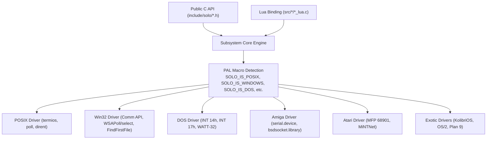

# Platform Abstraction Layer (PAL)

The **Platform Abstraction Layer (PAL)** decouples high-level public APIs and Lua bindings from OS-specific system calls, hardware I/O ports, and kernel architectures.

---

## PAL Directory Organization

Each subsystem contains a dedicated `*_pal.h` file that detects the host environment and provides unified internal signatures:

- [`src/socket/socket_pal.h`](file:///home/gustavo/Projetos/solo/src/socket/socket_pal.h)
- [`src/serial/serial_pal.h`](file:///home/gustavo/Projetos/solo/src/serial/serial_pal.h)
- [`src/filesystem/filesystem_pal.h`](file:///home/gustavo/Projetos/solo/src/filesystem/filesystem_pal.h)
- [`src/parallel/parallel_pal.h`](file:///home/gustavo/Projetos/solo/src/parallel/parallel_pal.h)
- [`src/sandbox/sandbox_pal.h`](file:///home/gustavo/Projetos/solo/src/sandbox/sandbox_pal.h)

---

## PAL Compilation Pipeline

---

## PAL Rules for Contributors

1. **No direct standard includes in public headers:** User code including `<solo/solo.h>` should not leak `<windows.h>`, `<sys/socket.h>`, or `<dos.h>`.
2. **Abstract socket types:** Use `SOLO_PAL_SOCK_T` and `SOLO_SOCK_IS_VALID()` because Windows uses `SOCKET` (unsigned integer) while POSIX uses `int` (signed integer).
3. **Interrupt Handling:** Loop on transient interrupt signals (`EINTR` on POSIX, `WSAEINTR` on Windows) via `SOLO_PAL_IS_INTR(err)`.
