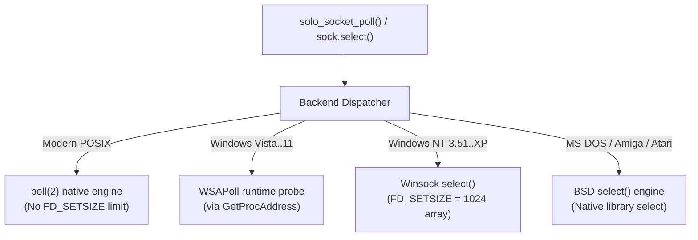

# Network Sockets & Multiplexing (`solo.socket`)

The `socket` subsystem provides raw IPv4 TCP (streaming) and UDP (datagram) networking, synchronous and asynchronous I/O, configurable timeouts, and multi-tier event multiplexing.

---

## TCP Client & Server

=== "C (C89)"

    ```c
    #include <stdio.h>
    #include <solo/solo.h>

    void run_tcp_client(void) {
        char err_buf[128];
        solo_socket_t *sock;
        size_t sent = 0;

        sock = solo_socket_connect("127.0.0.1", 8080, SOLO_SOCK_BLOCKING, err_buf, sizeof(err_buf));
        if (!sock) {
            fprintf(stderr, "Error: %s\n", err_buf);
            return;
        }

        solo_socket_send(sock, "GET / HTTP/1.0\r\n\r\n", 18, &sent);
        solo_socket_close(sock);
    }
    ```

=== "Lua"

    ```lua
    local sock = require("solo.socket")

    -- Server setup
    local server, err = sock.bind("0.0.0.0", 8080, sock.mode.BLOCKING)
    if not server then
        error("Bind error: " .. tostring(err))
    end

    print("Listening on 8080...")
    local client = server:accept()
    if client then
        local data = client:read(1024)
        client:write("HTTP/1.0 200 OK\r\n\r\nHello World!")
        client:close()
    end
    server:close()
    ```

---

## UDP Datagrams

=== "C (C89)"

    ```c
    #include <solo/solo.h>

    void send_udp_ping(void) {
        char err_buf[128];
        solo_socket_t *sock = solo_socket_udp(SOLO_SOCK_BLOCKING, err_buf, sizeof(err_buf));
        size_t sent = 0;

        if (sock) {
            solo_socket_sendto(sock, "ping", 4, "127.0.0.1", 9999, &sent);
            solo_socket_close(sock);
        }
    }
    ```

=== "Lua"

    ```lua
    local sock = require("solo.socket")

    local udp = sock.udp()
    udp:sendto("ping", "127.0.0.1", 9999)

    -- UDP receiver
    local server = sock.udp_bind("0.0.0.0", 9999)
    local data, sender_ip, sender_port = server:recvfrom(64)
    print(string.format("Received '%s' from %s:%d", data, sender_ip, sender_port))
    ```

---

## Multiplexing Beyond `select()`

Multiplexing in `solo` automatically adapts to host kernel capabilities:



### Multi-Tier Multiplexer Architecture

1. **Modern POSIX (`poll(2)`):** Used on Linux, macOS, FreeBSD, NetBSD, OpenBSD, Haiku, and Solaris. Completely bypasses the classic `FD_SETSIZE` ceiling, eliminating stack corruption risks when handling high descriptor values ($fd \ge 1024$).
2. **Windows Adaptive (`WSAPoll` / `select`):**
    * On Windows Vista, 7, 8, 10, 11 and Server 2008..2025: resolves `WSAPoll` dynamically at runtime via `GetProcAddress("ws2_32.dll", "WSAPoll")`.
    * On Windows NT 3.51, 4.0, 2000, and XP: transparently falls back to `solo_poll_via_select()`, preserving binary compatibility without breaking the PE loader.
    * Winsock `FD_SETSIZE` safe scaling: Winsock represents `fd_set` as an explicit array of socket handles rather than a bitmask; redefining `FD_SETSIZE` to 1024 expands polling capacity safely.
3. **Vintage BSD Stacks:** Stacks on MS-DOS (WATT-32 `select_s`), AmigaOS (`bsdsocket.library`), Atari ST (MiNTNet), OS/2, and Plan 9 utilize genuine BSD `select()`.
4. **Zero-Heap Fast Path:** Sockets arrays with up to 64 descriptors use an internal stack buffer (`stack_pfds[64]`). `malloc()` is only called for large descriptor sets.

### Multiplexing Example

=== "C (C89)"

    ```c
    solo_pollfd_t pfds[2];
    int ready;

    pfds[0].sock = s1;
    pfds[0].events = SOLO_SOCK_POLL_READ;
    pfds[0].revents = 0;

    pfds[1].sock = s2;
    pfds[1].events = SOLO_SOCK_POLL_READ;
    pfds[1].revents = 0;

    ready = solo_socket_poll(pfds, 2, 500); /* 500ms timeout */
    if (ready > 0) {
        if (pfds[0].revents & SOLO_SOCK_POLL_READ) {
            /* s1 is ready for reading */
        }
        if (pfds[1].revents & SOLO_SOCK_POLL_READ) {
            /* s2 is ready for reading */
        }
    }
    ```

=== "Lua"

    ```lua
    local sock = require("solo.socket")

    -- Monitors readers and writers with a 500ms timeout
    local ready_readers, ready_writers = sock.select({ s1, s2 }, nil, 500)

    for _, s in ipairs(ready_readers) do
        local msg = s:recvfrom(128)
        print("Received message: " .. msg)
    end
    ```
